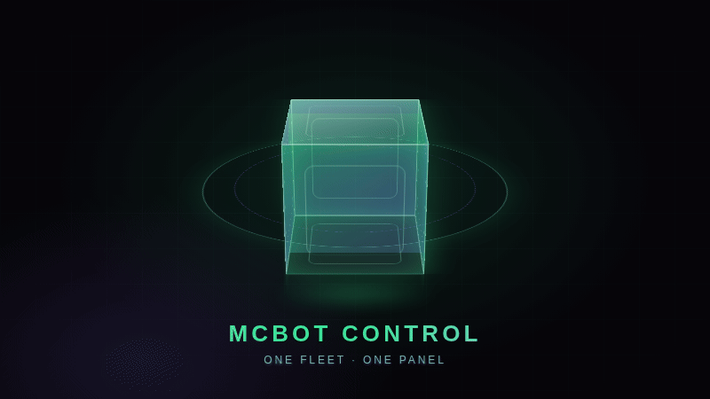
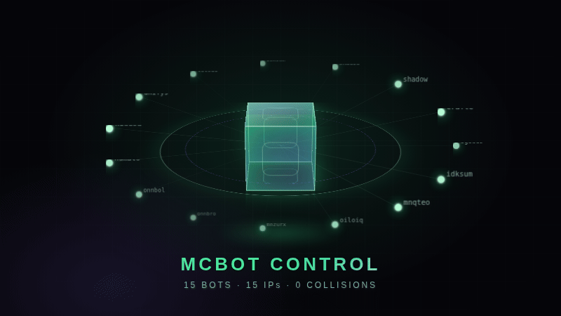
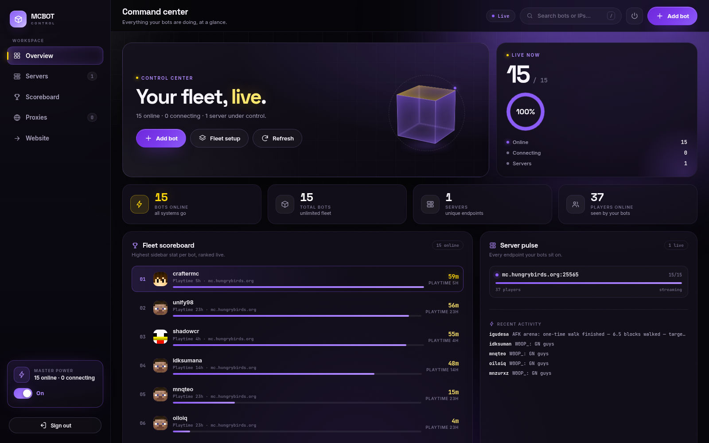
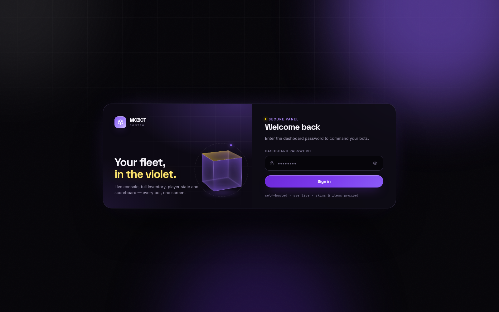
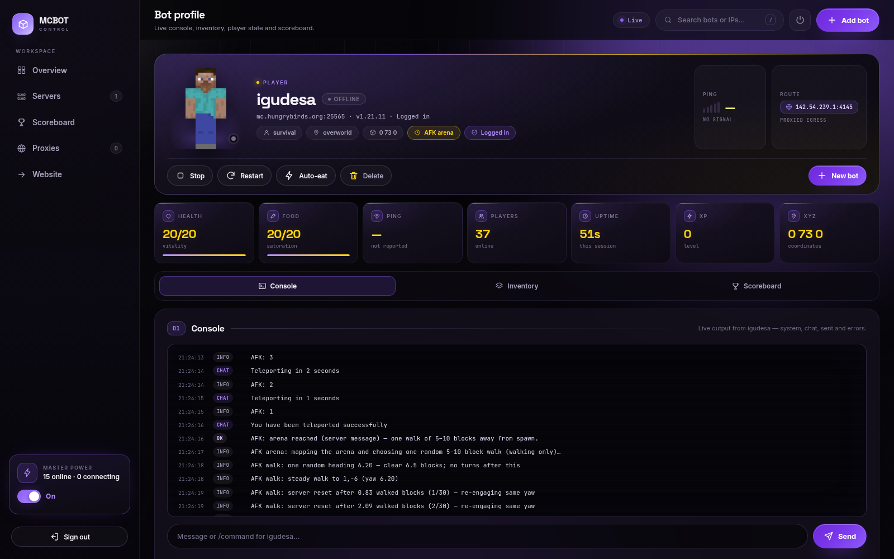
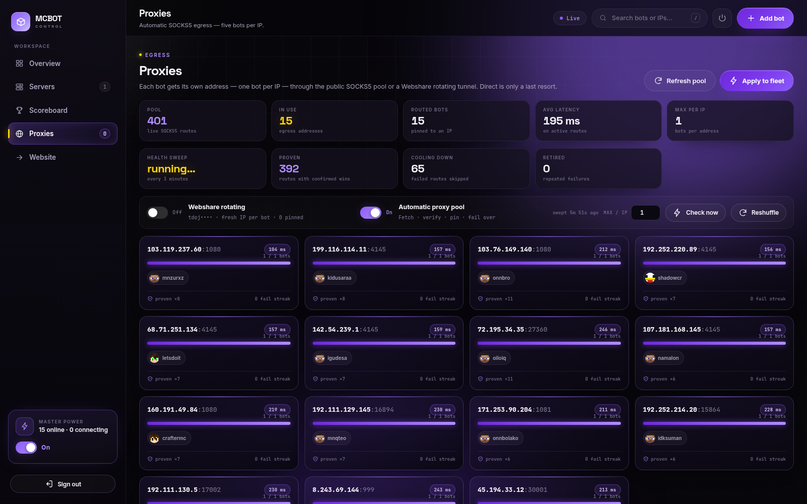
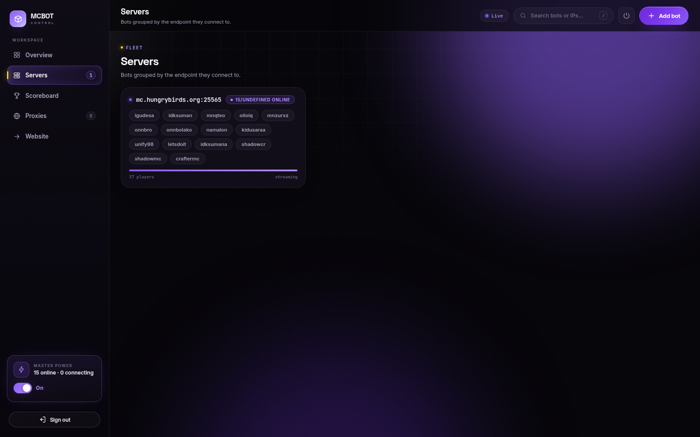
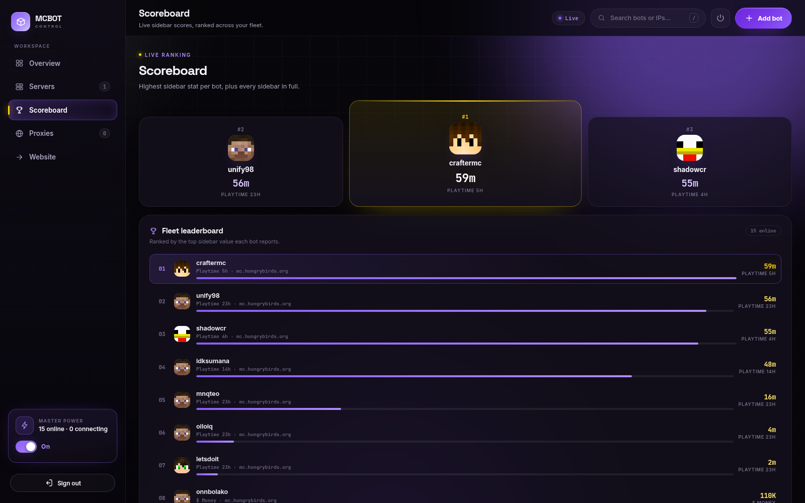

<div align="center">

# MCBot — Fleet Control

**One panel. Fifteen bots. Fifteen proxy IPs. Zero collisions.**

A self-hosted control room for Minecraft **1.21.11** bots, built on [Mineflayer](https://github.com/PrismarineJS/mineflayer). Every bot joins through its own proxy, logs in, goes to the AFK arena and stays there — while you watch chat, vitals, inventories, routes and scoreboard in one dark panel.

[](https://ro0mii.github.io/mcbot/)
[](#about)
[](#proxy-routing)
[](#license)

</div>

---

## About

MCBot started as a single terminal bot and grew into a small operations desk for a whole fleet. The problem it solves is simple to say and fiddly to do: **keep many Minecraft accounts online at once without ever exposing the host IP, and without two of them sharing an exit address.**

Each bot is assigned one pinned proxy route, keyed by the real host IP (so two ports on the same box count as the same address). It joins the server, sends `/login`, runs `/afk`, clicks GUI slot 1, teleports to the arena and performs **one short random-direction walk** per session. No mining, no digging, no placing — just enough motion to stay present.

Everything the bot sees is streamed to the panel: chat, health, food, XP, full inventory with real item textures, player skins, scoreboard and the proxy route it is currently using. If a route dies, the bot is re-homed to a better one **without ever falling back to a direct connection**.

<div align="center">

| | |
|:---:|:---:|
|  |  |
| **One control surface** | **One IP per bot** |

</div>

> **In one line:** a quiet, self-hosted room where every bot has its own door.

---

## At a glance

| | |
|---|---|
| Server | `mc.hungrybirds.org:25565` · Minecraft **1.21.11** |
| Fleet | 15 bots, all in the AFK arena |
| Routing | Proxy-only, sticky by IP · `collisions 0` · `uniqueIps 15` |
| Uptime | Lifetime-based route ranking, unlimited sessions |
| Panel | Port 80, live SSE, no frontend build step |
| Stack | Node.js 18+ · Mineflayer 4 · vanilla HTML/CSS/JS |

---

## See the panel

An 18-second walkthrough of the real dashboard — login, 15-bot overview, one bot's detail page, proxy pool, servers and scoreboard.

[](docs/screenshots/panel-demo.mp4)

**Watch:** [panel-demo.mp4](docs/screenshots/panel-demo.mp4) · **Live page:** [ro0mii.github.io/mcbot](https://ro0mii.github.io/mcbot/)

| Login | Fleet overview | Bot detail |
|:---:|:---:|:---:|
| [](docs/screenshots/01-login.png) | [](docs/screenshots/02-overview.png) | [](docs/screenshots/03-bot-detail.png) |

| Proxy pool | Servers | Scoreboard |
|:---:|:---:|:---:|
| [](docs/screenshots/04-proxies.png) | [](docs/screenshots/05-servers.png) | [](docs/screenshots/06-scoreboard.png) |

---

## What it does

- **One bot per IP** — sticky proxy assignment keyed by real host, so two ports on the same box never collide. `collisions 0`, `uniqueIps = fleet size`.
- **Proxy-only egress** — no direct fallback: if there is no usable route, the bot waits rather than exposing the host IP.
- **Lifetime uptime filtering** — routes are ranked `good → trial → curated → asian → rest` by cumulative uptime, not by a single lucky session. Dead routes are pruned; the live pool is capped at **400 routes / 200 discovery candidates**.
- **Server-error-aware routing** — Velocity/auth hiccups (`internal error`, `unable to connect to auth`, `disconnect.timeout`) keep the proven route and rejoin after ~30s instead of burning good IPs on untested ones.
- **Temporary ban handling** — the stated duration is parsed (`3 Days` → 72h) and the bot auto-restarts after it expires. Permanent bans are never retried automatically.
- **One real AFK walk** — after spawn → `/login` → `/afk` → GUI slot 1 → teleport, each session does exactly **one 5–10 block walk** in a validated random direction. No mining, digging or placing.
- **Live panel** — chat stream, per-bot console, real inventory, skin/body, health/food/XP, server pulse, sidebar scoreboard, group commands.
- **Low footprint** — only the required mineflayer plugins, view distance 2, distant chunks dropped periodically.
- **Auto-eat / auto-login / auto-reconnect** — new bots default to anti-AFK off, auto-eat on.

---

## Quick start

**Panel (fast install — about 5s, no Discord/CLI deps):**

```bash
git clone https://github.com/RO0MII/mcbot.git
cd mcbot
npm run setup       # installs runtime deps, rebuilds assets, starts port 80
npm start           # panel is already up; this re-checks and prints the URL
```

`npm run setup` is safe to run again — it skips existing downloads. Use `sudo` if your user cannot write to `/etc/systemd/system`.

Open `http://localhost/` (or the host's IP) and sign in with the password set in `DASHBOARD_PASSWORD`.

```bash
npm run dashboard   # foreground, no systemd
npm run bot         # original terminal-only bot
npm run discord     # Discord bridge
npm run start:all   # terminal bot + Discord bridge
```

> Set `DASHBOARD_PASSWORD` before exposing port 80 to the internet. Runtime state (`dashboard/data/` — bot configs, caches, proxy pool) is **git-ignored**; no credentials are committed.

New bots default to: anti-AFK **off**, auto-eat **on**, auto-login password `Sandun123`, dashboard password `Sandun123`.

---

## Panel guide

| View | What you get |
|---|---|
| **Overview** | Fleet cards with status, egress IP, uptime, players, vitals, inventory strip and last log line. Filter chips + live search. |
| **Bot detail** | Full console (type server commands), inventory, player state, scoreboard and per-bot actions. |
| **Servers** | Bots grouped by endpoint, with player counts counted once per server. |
| **Scoreboard** | Highest sidebar stat per bot plus every live sidebar. |
| **Proxies** | Live SOCKS routes, health sweep, proven routes, pinned bots and cooldowns. |

Group commands are typed once and fan out to every online bot in the group; offline bots are skipped and named.

---

## Proxy routing

- Assignments are pinned per bot and keyed by **IP**, not `host:port`.
- A route is retired only after repeated failures: a live-session drop escalates **10 min → 30 min → retire on the third**.
- Handshake failures get a short cooldown; proven routes survive transient server errors.
- A `"This player is already online"` kick waits out the ghost session (~45s) instead of cycling IPs.
- Permanent bans stop the bot until manually cleared. Temporary bans show the countdown and auto-rejoin.
- Server staff rules: max 10 alts, one bot per IP, permanent bans cannot be unbanned. Appeals: `https://discord.gg/sgrcFUdjXU`.

Tests: `cd dashboard && node --test test/*.test.js` — routing, uptime tiers, walking and ban parsing are covered (**47 tests**).

---

## Original terminal bot (legacy)

`index.js` is the original single-bot CLI, pinned to **1.20.1**.

```bash
npm run bot
```

It prompts for a player name and server IP (`host` or `host:port`, Enter = `localhost:25565`). Type plain text for chat, `/` for a server command, `!` for a local bot command.

| Command | Description |
|---|---|
| `!help` | List bot commands |
| `!afk on` / `!afk off` | Toggle anti-AFK movement |
| `!pos` | Current coordinates |
| `!health` | Health and hunger |
| `!players` | Online players |
| `!follow <name>` | Pathfind to a player |
| `!stop` | Stop following |
| `!quit` | Disconnect and exit |

Auto-respawn is always on. `quit` / `exit` / **Ctrl+C** exits the CLI.

**Configuration** — settings at the top of [`index.js`](index.js):

| Setting | Default | Description |
|---|---|---|
| `DEFAULT_IP` | `localhost` | IP used when you press Enter |
| `DEFAULT_PORT` | `25565` | Default port |
| `VERSION` | `1.20.1` | Pinned version; `false` auto-detects |
| `AUTO_RECONNECT` | `true` | Retry while the server boots |
| `RECONNECT_DELAY` | `5000` | ms between retries |
| `JOIN_TIMEOUT` | `30000` | ms before a stalled join is retried |

Offline (`auth: 'offline'`) is the default; switch to `auth: 'microsoft'` inside `connect()` for premium servers.

---

## Tech stack

- [Node.js](https://nodejs.org/) 18+
- [Mineflayer](https://github.com/PrismarineJS/mineflayer) `^4.20.1`
- [mineflayer-pathfinder](https://github.com/PrismarineJS/mineflayer-pathfinder) `^2.4.5`
- Vanilla HTML/CSS/JS panel with Server-Sent Events — no frontend build step

---

## License

MIT — free to use, modify, and share.
